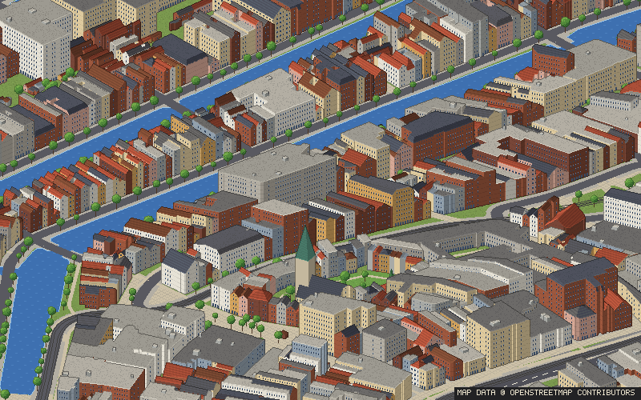
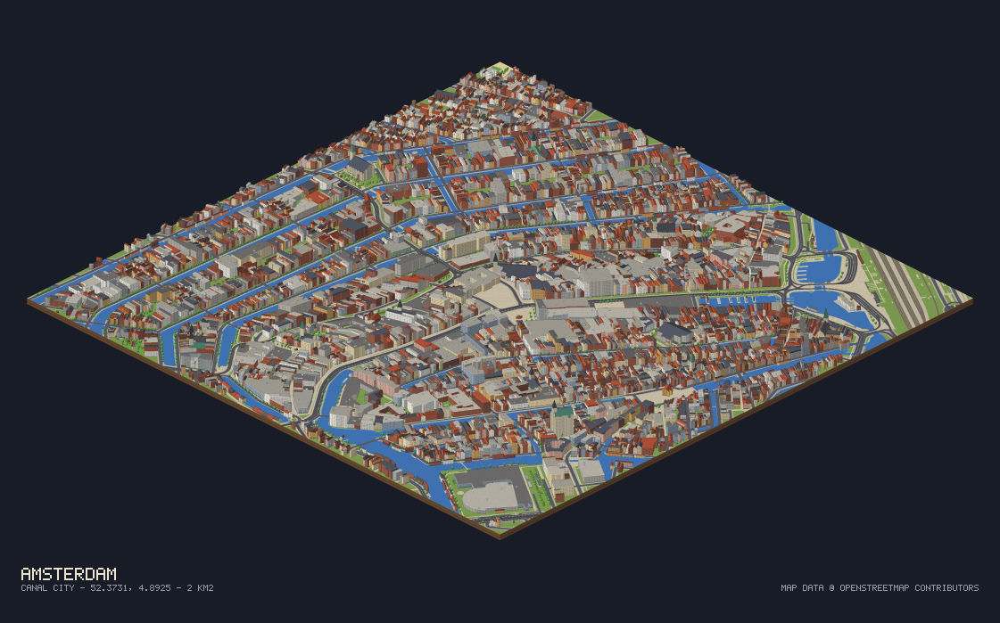
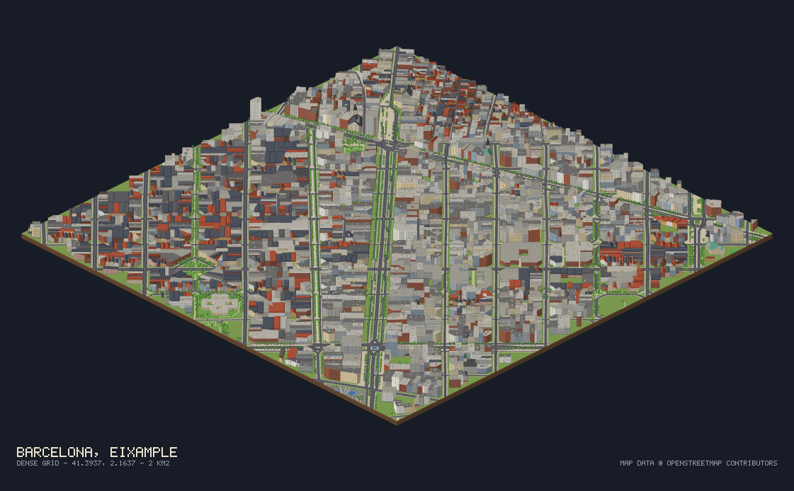
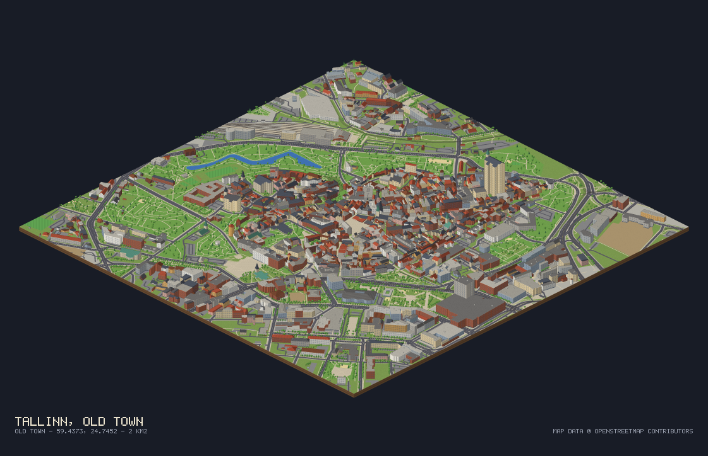
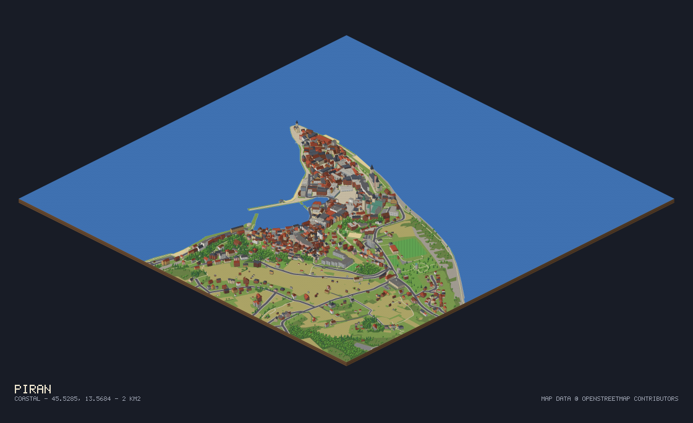
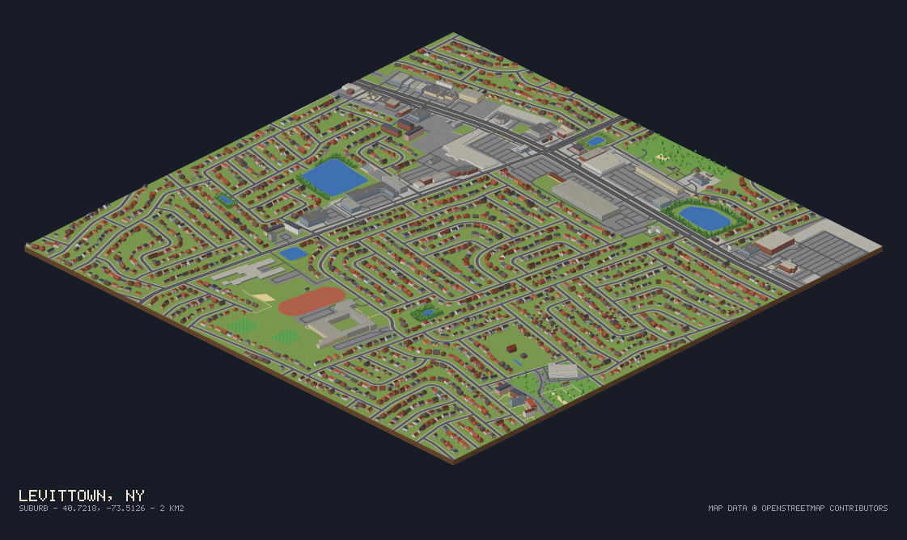
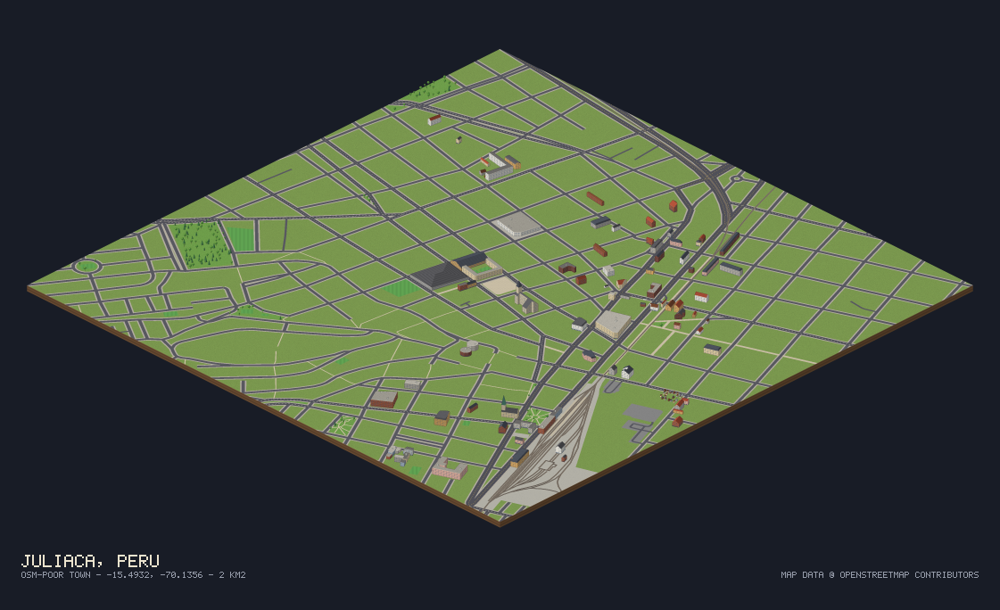

# isotown

Your city as a zoomable SimCity-2000-style pixel map, from OpenStreetMap, in one command.

[](https://kova1max.github.io/isotown/demo/amsterdam/)

<sub>Central Amsterdam, straight out of `npx isotown "Amsterdam"`. Map data © OpenStreetMap contributors. Click for the zoomable map.</sub>

```sh
npx isotown "Amsterdam"
```

Nothing else to install, no API key, no sign-up. isotown turns the OpenStreetMap buildings, roads, water and trees of a city core into gabled, windowed, hard-pixel sprites you can zoom from the whole district down to a single window, then lights the windows up at night. No AI model and no GPU: every pixel comes from rules over OSM tags.

**5,761 buildings of central Amsterdam rendered in 2.7 s on an Apple M4 laptop, 0 GPU, 0 API keys.** That is the render alone, from the download cache. The first run also has to download the area from the public Overpass servers, which took 161 s to 1,168 s per 2 km² city core in our cold-cache run, almost all of it queueing on busy servers. Rerun both yourself with [`bench/run.sh`](bench/run.sh); raw numbers in [`bench/results.json`](bench/results.json) and [`bench/results-cold.json`](bench/results-cold.json).

```text
$ npx isotown "Amsterdam"
geocoded: Amsterdam, Noord-Holland, Nederland (52.37308, 4.89245)
fetched 1/4 cells
fetched 2/4 cells
fetched 3/4 cells
fetched 4/4 cells
5,761 buildings, 1,718 roads, 1,347 trees in 2 km2
rendering 4,292 x 2,353 px
wrote index.html, 247 tiles, poster.png, daynight.gif to ./isotown-amsterdam in 383.0 s
network: 7 requests, 0 cache hits
open ./isotown-amsterdam/index.html in a browser to explore the map
Map data © OpenStreetMap contributors (ODbL). Keep this attribution when you share the images.

isotown-amsterdam/
├── index.html      zoomable viewer, works from disk or any static host
├── map.dzi
├── map_files/      deep-zoom tile pyramid
├── poster.png      the whole map with title and attribution
├── daynight.gif    800x500, day to night, windows switching on
└── isotown.json    what was rendered, and how long it took
```

## Gallery

[Live demo: central Amsterdam, zoomable](https://kova1max.github.io/isotown/demo/amsterdam/). Six city cores of 2 km², all with the default rules and no per-city tuning (click for a full-resolution close-up):

| | | |
|:-:|:-:|:-:|
| [](docs/gallery/amsterdam-zoom.png) canal city | [](docs/gallery/barcelona-eixample-zoom.png) dense grid | [](docs/gallery/tallinn-old-town-zoom.png) old town |
| [](docs/gallery/piran-zoom.png) coastal | [](docs/gallery/levittown-zoom.png) suburb | [](docs/gallery/juliaca-zoom.png) OSM-poor town |

Juliaca is shown as it really renders: a busy city whose centre has only 106 buildings mapped in these 2 km². isotown only draws what OpenStreetMap knows, so the map is as good as the local mapping. Every building you add on [openstreetmap.org](https://www.openstreetmap.org) shows up once the cached download is refreshed (delete `~/.cache/isotown`).

## What you get

- **`index.html` + `map_files/`**: a deep-zoom tile pyramid with an [OpenSeadragon](https://openseadragon.github.io/) viewer. Smooth when zoomed out, hard pixels when zoomed in. It opens straight from disk, and the folder is a ready static site; to publish it on GitHub Pages:

  ```sh
  npx isotown "Lisbon" --out docs/lisbon
  git add docs && git commit -m "my city" && git push
  # Settings → Pages → Deploy from branch → /docs
  ```

- **`poster.png`**: the whole map, framed, with the place name and the OpenStreetMap attribution burned in.
- **`daynight.gif`**: 16 frames, 800×500, from day to night with the windows switching on one by one.

## How it works

1. **Geocode** the place once with Nominatim, take a square of `--area` km² around it, and split it into cells of at most 1 km.
2. **Fetch** each cell from Overpass, one request at a time, caching every cell on disk, so a repeated or interrupted run resumes and a second run makes zero requests.
3. **Classify** buildings into six roof rules by building class: flat with parapet and rooftop boxes (shops, offices, industry, anything 6+ levels), gabled along the long axis (houses, terraces, small blocks), hipped (square houses, mid-size blocks), pyramidal (small square houses), mansard (mid-rise apartment blocks), skillion (garages and sheds). Churches get a steep roof and a tower with a spire. A `roof:shape` tag always wins. Heights come from `height` and `building:levels`, with a default per class when neither is tagged.
4. **Rasterise** everything in software: one depth buffer over the whole map instead of a painter's sort, walls in three tones by orientation, a row of windows per level, roads with sidewalks and centre lines, water with a shoreline highlight, sprite trees, and the sea filled from OSM coastlines.
5. **Write** the tile pyramid, the poster and the GIF. Pure TypeScript with two dependencies, [pngjs](https://github.com/pngjs/pngjs) and [gifenc](https://github.com/mattdesl/gifenc).

How much the look can rely on tags varies a lot by city. In the six gallery cores:

| city | buildings | with `height` | with `building:levels` | with a type other than `yes` |
|---|--:|--:|--:|--:|
| Amsterdam | 5,761 | 87.2% | 5.6% | 66.2% |
| Barcelona, Eixample | 2,624 | 1.1% | 62.6% | 93.5% |
| Tallinn old town | 1,411 | 58.7% | 39.0% | 35.2% |
| Piran | 789 | 0.1% | 5.1% | 25.1% |
| Levittown, NY | 1,787 | 0% | 0.1% | 96.0% |
| Juliaca, Peru | 106 | 0% | 0.9% | 14.2% |

<sub>From `bench/results.json`, measured by `bench/run.sh`.</sub>

## Why this instead of…

- **[iso-cities](https://github.com/RayNCooper/iso-cities)** builds isometric cities in the browser with flat extruded prisms. Its advertised npx package was not on npm (E404, checked 2026-11-15). Better at: live in-browser editing.
- **Image-model city maps** such as [isometric.nyc](https://isometric.nyc): hand-curated, one city each, and they need a model plus a GPU or a paid API. Better at: painterly detail and landmarks that look like the real thing.
- **[maptoposter](https://github.com/originalankur/maptoposter)** makes any-city line-art posters. Better at: clean typography and print-ready posters. It is flat, not isometric.

isotown is for when you want *your* city, as pixel art, from one command, with a map you can zoom into.

## Limits

- A city core, not a whole city: up to 25 km², refused above that. Whole cities from a local extract (`--pbf`) are planned.
- No terrain, bridges, labels or landmark models; `building:part` 3D detail is ignored.
- The look depends on the local OSM tagging: untagged heights fall back to defaults per building class.
- It uses the public Overpass and Nominatim services politely: sequential requests, a cache, a descriptive User-Agent, and fallback across public Overpass mirrors. Please use `--overpass-url` with your own instance for anything heavy.

## Options

| option | default | |
|---|---|---|
| `--area <km2>` | `2` | size of the square city core, up to 25 |
| `--out <dir>` | `./isotown-<place>` | output directory |
| `--gif-at <lat,lon>` | map centre | centre of the day/night GIF |
| `--overpass-url <url>` | public mirrors | your own Overpass endpoint |
| `--nominatim-url <url>` | `https://nominatim.openstreetmap.org` | your own Nominatim endpoint |
| `--cache-dir <dir>` | `~/.cache/isotown` | download cache (`$XDG_CACHE_HOME/isotown` if set) |

The place can also be given as `"<lat>,<lon>"`, which skips geocoding. Requires Node.js 18 or newer.

From source:

```sh
git clone https://github.com/kova1max/isotown && cd isotown
npm install && npm run build
node dist/cli.js "Amsterdam"
```

## Why I built this

<!-- Launch copy is written by hand before release; this section is a factual stand-in. -->
Isometric maps of single cities keep turning up and people keep asking for their own city. Most of them are made with image models, one city at a time. OpenStreetMap already knows where every building is, how tall many of them are and what they are used for, so a set of plain rules should be able to draw any city in the same style, on a laptop, in seconds.

## Data and license

The code is [MIT](LICENSE). Everything isotown draws is OpenStreetMap data, © OpenStreetMap contributors, available under the [Open Database License](https://www.openstreetmap.org/copyright). The attribution is embedded in `poster.png`, `daynight.gif` and the viewer, and must be kept when you share them.
